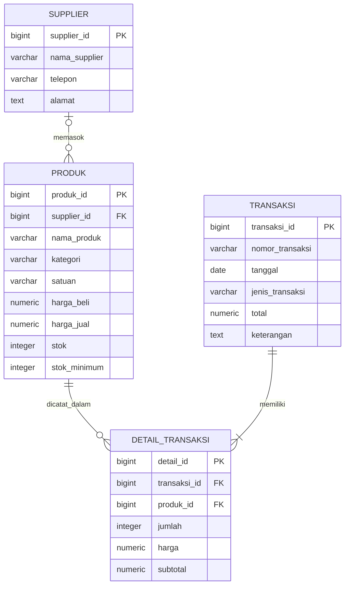

# 🌷 SISTEM PERSEDIAAN FLORIST

<div align="center">

### Tugas Mata Kuliah Pengkodean dan Pemrograman

**Jasmine Aisyah Putria**  
**NIM: 12030124140328**  
**Mata Kuliah/Kelas: Pengkodean dan Pemrograman / G**  
**Dosen Pengampu: Dr. Totok Dewayanto, S.E., M.Si., Akt., CA**

**PROGRAM STUDI S1 AKUNTANSI**  
**FAKULTAS EKONOMIKA DAN BISNIS**  
**UNIVERSITAS DIPONEGORO**

</div>

---

## 📖 Deskripsi Sistem

**Sistem Persediaan Florist** adalah aplikasi web untuk membantu toko florist mengelola data produk dan supplier, mencatat barang masuk dan keluar, serta memantau jumlah dan nilai persediaan. Aplikasi menyediakan dashboard, pencarian data, dan peringatan produk dengan stok rendah.

Frontend dibuat menggunakan HTML, CSS, dan JavaScript. Data disimpan di Supabase dengan PostgreSQL, dan aplikasi berkomunikasi dengan database melalui Supabase JavaScript Client.

## ✨ Fitur Utama

| Fitur | Deskripsi |
|---|---|
| 📊 Dashboard | Ringkasan jumlah produk, supplier, stok, dan transaksi; menampilkan produk terbaru serta stok rendah. |
| 🌸 Produk | Menambah, mengubah, menghapus, dan mencari produk; mencatat kategori, satuan, harga, stok, dan supplier. |
| 🌿 Supplier | Menambah, mengubah, menghapus, dan mencari data supplier. |
| 🧾 Transaksi | Mencatat transaksi barang masuk dan keluar beserta produk, jumlah, dan harga. |
| 🔄 Pembaruan stok | Stok disesuaikan setelah transaksi; transaksi keluar ditolak jika jumlah melebihi stok tersedia. |
| 📈 Laporan persediaan | Menampilkan rincian produk dan nilai persediaan berdasarkan harga beli. |
| ⚠️ Stok minimum | Menandai produk yang stoknya sama dengan atau di bawah batas minimum. |

## 🛠️ Teknologi

| Komponen | Teknologi |
|---|---|
| Frontend | HTML5, CSS3, JavaScript (Vanilla) |
| Database | Supabase / PostgreSQL |
| Client library | Supabase JavaScript Client v2 melalui jsDelivr CDN |
| Tipografi | Times New Roman; Playfair Display dimuat dari Google Fonts |

## 🗂️ Struktur Database

Database terdiri dari empat tabel utama:



Supplier dapat memasok banyak produk. Setiap transaksi memiliki satu atau lebih detail transaksi; setiap detail mengacu pada satu produk. Jenis transaksi yang didukung adalah `MASUK` dan `KELUAR`.

## 📁 Struktur Folder

```text
sistem-persediaan-florist/
├── front-end/
│   ├── index.html       # Halaman aplikasi
│   ├── style.css        # Gaya dan tata letak
│   └── script.js        # Logika aplikasi dan koneksi Supabase
├── back-end/
│   ├── app.js           # Konfigurasi Supabase
│   └── database.sql     # Skema, kebijakan akses, dan data awal
└── readme.md            # Dokumentasi proyek
```

## 🚀 Cara Menjalankan

### 1. Siapkan database Supabase

1. Buat project di [Supabase](https://supabase.com).
2. Buka **SQL Editor** pada dashboard project.
3. Buka [`back-end/database.sql`](back-end/database.sql), lalu jalankan isinya di SQL Editor.

> **Penting:** Skrip SQL menghapus tabel `detail_transaksi`, `transaksi`, `produk`, dan `supplier` yang sudah ada sebelum membuat ulang skema. Gunakan hanya pada database baru atau setelah membuat backup; menjalankannya ulang dapat menghapus data.

### 2. Atur koneksi aplikasi

1. Buka **Project Settings → API** di Supabase.
2. Salin **Project URL** dan kunci publik (`anon` atau `publishable`) project.
3. Ganti nilai `SUPABASE_URL` dan `SUPABASE_ANON_KEY` pada [`front-end/script.js`](front-end/script.js) dengan nilai project milikmu.

Jangan gunakan `service_role` atau secret key di kode frontend. File [`back-end/app.js`](back-end/app.js) juga berisi variabel konfigurasi, tetapi halaman aplikasi memuat koneksi dari `front-end/script.js`.

### 3. Buka aplikasi

Buka `front-end/index.html` di browser, atau jalankan folder `front-end` menggunakan ekstensi **Live Server** di VS Code. Koneksi internet diperlukan untuk mengakses Supabase dan memuat Supabase JS dari CDN.

## 🔐 Catatan Keamanan

SQL mengaktifkan Row Level Security (RLS), tetapi kebijakan yang disertakan memberikan akses baca dan tulis penuh kepada role `anon`. Ini sesuai untuk demonstrasi lokal/akademik, bukan deployment produksi. Sebelum digunakan secara publik, tambahkan autentikasi dan batasi kebijakan RLS sesuai pengguna serta kebutuhan aplikasi.

## 📋 Kebutuhan

- Browser modern seperti Chrome, Edge, Firefox, atau Safari.
- Koneksi internet.
- Project Supabase dengan skema yang dibuat dari `back-end/database.sql`.

## 👩‍🎓 Informasi Penulis

| | |
|---|---|
| **Nama** | Jasmine Aisyah Putria |
| **NIM** | 12030124140328 |
| **Mata Kuliah/Kelas** | Pengkodean dan Pemrograman / G |
| **Dosen Pengampu** | Dr. Totok Dewayanto, S.E., M.Si., Akt., CA |
| **Program Studi** | S1 Akuntansi |
| **Fakultas** | Ekonomika dan Bisnis |
| **Universitas** | Universitas Diponegoro |

---

<div align="center">

### 🌷 Terima Kasih 🌷

*Sistem Persediaan Florist — Solusi Digital untuk Toko Bunga Modern*

**© 2025 Jasmine Aisyah Putria — Universitas Diponegoro**

</div>
